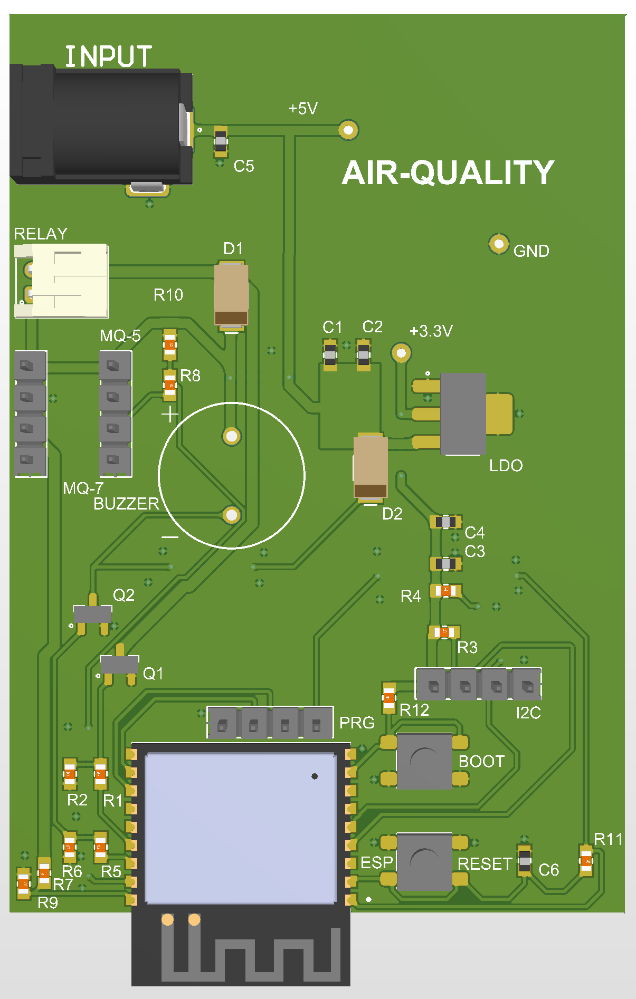

# AIR-QUALITY — Nodo IoT de Monitoreo Ambiental (Rev. D)

Sistema embebido compacto (**50,64 mm**) basado en **ESP32** para la detección, acondicionamiento y telemetría de gases inflamables y monóxido de carbono.

  

## Resumen de Ingeniería
* **Unidad de Procesamiento y RF:** Módulo ESP32 con zonificación topológica por cuadrantes y área *keep-out* libre de cobre bajo la antena impresa para preservar la impedancia característica ($Z_0 = 50\,\Omega$).
* **Etapa de Sensado:** Integración de sensores semiconductores **MQ-2** (GLP, humo, propano) y **MQ-7** (monóxido de carbono).
* **Acondicionamiento Analógico:** Divisores resistivos de precisión (relación 1:2) para adaptación de rango e impedancia hacia el ADC del ESP32, logrando un error experimental $\le 4\text{ mV}$ en el rango de $1\text{--}5\text{ V}$.
* **Gestión de Potencia y Eficiencia:** Regulación lineal mediante **AMS1117-3.3** ($T_J \approx 78,55\,^\circ\text{C}$, rizado $< 12\text{ mV}_{\text{PP}}$) y conmutación *low-side* por MOSFET para el control energético de los calefactores de los sensores.

## Estructura del Repositorio
* **Documentación:** `AIR-QUALITY.pdf` — Nota de Aplicación e Informe de Ingeniería (`ER_202611_AQ_001`).
* **Diseño CAD (Altium Designer):** Proyecto completo (`D_Firts_Project.PrjPcb`), esquemáticos jerárquicos (`Main.SchDoc`, `ESP32.SchDoc`), layout (`PCB_AIR_QUALITY.PcbDoc`), librerías (`Schlib1.SchLib`, `PcbLib1.PcbLib`) y salidas (`D_Firts_Project.OutJob`).
* **Firmware y Datos:** Configuración PlatformIO (`platformio.ini`) y registro de pruebas (`lecturas_sensor.txt`).
* **Evidencias Visuales:** Render 3D de la tarjeta (`PCB_3d.png`) y montaje experimental en protoboard (`poc_proto.jp.jpeg`).
